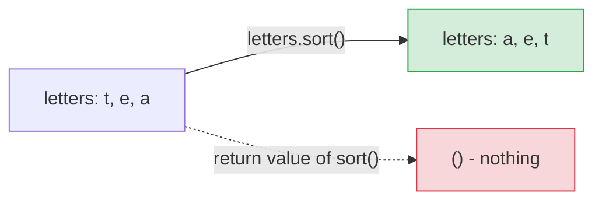
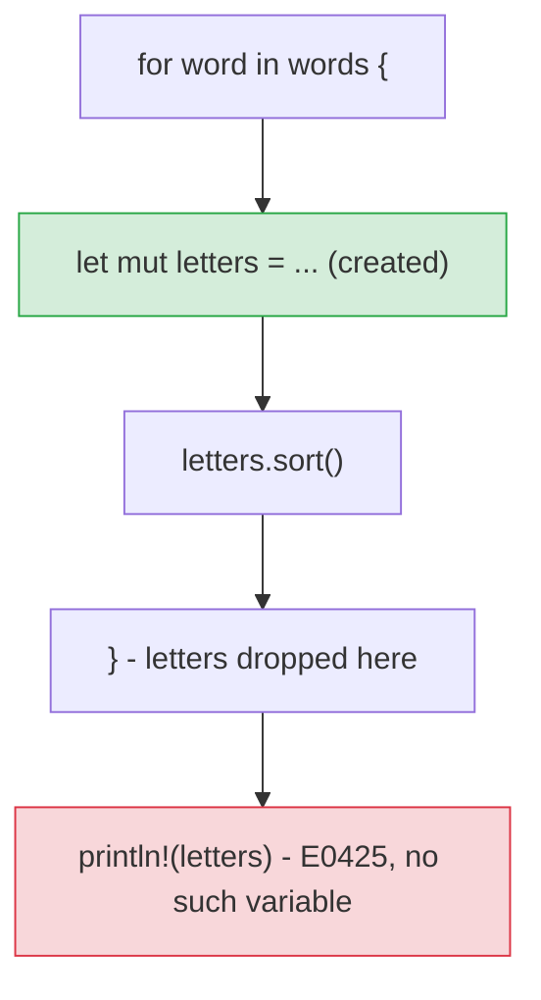
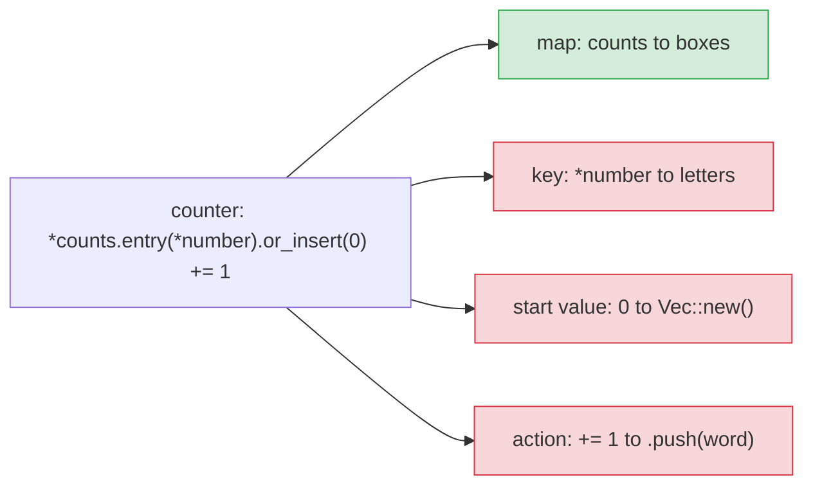
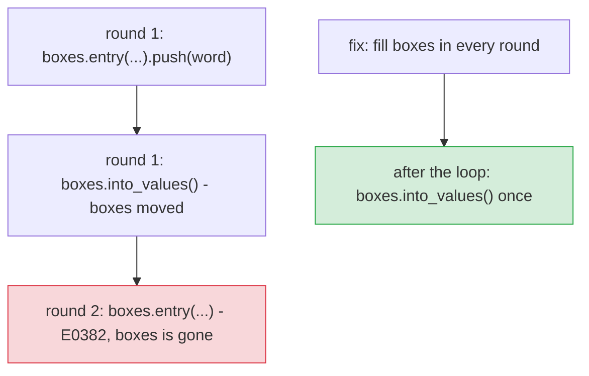

# Ch 4 - My mistakes and misunderstandings

## Open mistakes (review these)

### 2026-10-22 - Owned text confused with Copy (string-views warm-up)
- **What I wrote:** "the difference between String and &str is that: String is a copy type and &str is borrowed"
- **Why it's wrong:** Owning text does not imply implicit copying. `String` does not implement `Copy`; assignment such as `let b = a;` transfers ownership. The first attempt repeated this move and then used `a`, producing E0382.
- **The rule:** `String` owns its text buffer; `&str` borrows text. Use `&` when access should be borrowed, and distinguish copying a shared reference from duplicating the text it references.
- **Status:** fresh - corrected with guidance and implemented; independent recall pending
- **See also:** [[strings]]; [[../02-ownership/ownership]]

### 2026-11-18 - `as` casts only its neighbour (median-mode, ex 1)
- **What I wrote:** `(numbers[middle] + numbers[middle - 1]) / 2 as f64`
- **Why it's wrong:** `as` binds tighter than `/`, so only the literal `2` became `f64`. The sum stayed `i32`, giving an `i32 / f64` mismatch, and integer addition/division would truncate anyway.
- **The rule:** Cast each operand before the arithmetic: `(a as f64 + b as f64) / 2.0`.
- **Status:** 🔴 fresh

### 2026-11-18 - `if`/`else` branches with different types (median-mode, ex 1)
- **What I wrote:** `if` branch `(... as f64 + ... as f64) / 2 as f64`, `else` branch `numbers[middle]`
- **Why it's wrong:** `if`/`else` is an expression producing one value for one variable, so every branch must have the same type. `f64` vs `i32` is E0308.
- **The rule:** When an `if` is assigned to a variable, check that each branch ends in the same type.
- **Status:** 🔴 fresh

### 2026-11-18 - Function body with no tail expression (median-mode, ex 1)
- **What I wrote:** `fn median_mode(number: Vec<i32>) -> (f64, i32){ let mut counts: HashMap<i32, usize> = HashMap::new(); }`
- **Why it's wrong:** A function returns its last expression without `;`. A body ending in a `let` statement returns `()`, which breaks the promised `(f64, i32)`.
- **The rule:** The returned value must be the final line with no semicolon, e.g. `(median, mode)`.
- **Status:** 🔴 fresh

### 2026-11-18 - Copying placeholders and examples literally (median-mode, ex 1)
- **What I wrote:** `*counts.entry(KEY).or_insert(0) += 1;` outside a loop; later pasted the `letters` / `letter_counts` example unchanged, so `counts` stayed `{}`; then `key; value;` as a loop body.
- **Why it's wrong:** `KEY` was a placeholder, not a variable (E0425). An analogous example shows a shape to adapt, not code to paste. A bare `key;` names a value and discards it (path statement with no effect).
- **The rule:** Map each name in an example to my own variables before typing. A `does not need to be mutable` or `unused variable` warning means the code meant to use that variable is missing.
- **Status:** 🔴 fresh

### 2026-11-18 - `mut` on the wrong binding after a move (median-mode, ex 1)
- **What I wrote:** `let mut numbers: Vec<i32> = vec![1, 1, 2, 2];` in `main`, with `fn median_mode(numbers: Vec<i32>)` still calling `numbers.sort()`
- **Why it's wrong:** Passing `numbers` moves the Vec into the function's parameter, a separate binding. Mutability belongs to the binding, so the parameter needs `mut` (E0596) and `main`'s binding does not.
- **The rule:** The variable that calls a `&mut self` method such as `sort()` is the one that needs `mut`; each new owner declares its own mutability.
- **Status:** 🔴 fresh

### 2026-11-18 - Stored the result of `sort()` in a variable (anagram-groups, ex 2)
- **What I wrote:** `let tray = letters.sort();` then `println!("{:?}", tray)`, which printed `()`
- **Why it's wrong:** `sort()` changes the Vec in place and returns nothing. "Nothing" in Rust is the unit value `()`, so `tray` holds `()`, not a sorted Vec. The sorted letters are in `letters`. Also removed `mut` from `letters` first because of the "does not need to be mutable" warning, although the missing `sort()` line was the real cause.
- **The rule:** `sort()` is a command, not a question: call it as a statement (`letters.sort();`) and then use the same variable. If a `{:?}` print shows `()`, the method returned nothing.
- **Status:** 🔴 fresh
- **See also:** [[vec]]

### 2026-11-18 - Used a loop variable after the loop (anagram-groups, ex 2)
- **What I wrote:** `for word in words { let mut letters: Vec<char> = word.chars().collect(); letters.sort(); }` and then `println!("{:?}", letters);` below the closing `}` of the loop
- **Why it's wrong:** `letters` is created inside the loop body. A variable lives only until the `}` that closes the block where `let` created it. Each round of the loop makes a new `letters` and drops it at the `}`. After the loop, no `letters` exists (E0425: cannot find value in this scope).
- **The rule:** Use a variable inside the same `{ }` where `let` created it. Code that needs the value for each item goes inside the loop body.
- **Status:** 🔴 fresh
- **See also:** [[../01-fundamentals/variables]]

### 2026-11-18 - Copied the counter line without adapting it (anagram-groups, ex 2)
- **What I wrote:** `*boxes.entry(*word).or_inssert(0) +=1;` as the first line of the loop body, above the lines that make `letters`
- **Why it's wrong:** Only the map name changed. The key was the word, but the map's key type is `Vec<char>` (the sorted letters), so `entry(*word)` is E0308. The start value `0` and the action `+= 1` belong to a counter, but each value here is a `Vec<String>` that needs `.push(word)`. The line also ran before `letters` existed, and `or_inssert` is a typo (E0599). Same pattern as the median-mode entry "Copying placeholders and examples literally".
- **The rule:** Before I reuse a line, name each part (map, key, start value, action) and replace every part for the new job. The key must have the type between `HashMap<` and the first comma. A line can only use a value that an earlier line made.
- **Status:** 🔴 fresh (second occurrence of this pattern)
- **See also:** [[hashmap]]

### 2026-11-18 - Consumed the map inside the loop (anagram-groups, ex 2)
- **What I wrote:** `let group: Vec<Vec<String>> = boxes.into_values().collect();` inside the `for word in words { ... }` body, below the `boxes.entry(letters)...push(word);` line
- **Why it's wrong:** `into_values(self)` takes ownership of the map, so `boxes` is moved (gone) at the end of the first round. The second round calls `boxes.entry(...)` on a moved value: E0382 "value borrowed here after move ... in previous iteration of loop". The compiler suggests `.clone()`, but that hides the real problem, which is the position of the line.
- **The rule:** A line that uses a collection completely (`into_values`, `into_iter`, passing it by value) runs once, after the loop that fills the collection. Inside the loop, only fill.
- **Status:** 🔴 fresh
- **See also:** [[hashmap]]; [[../02-ownership/ownership]]

